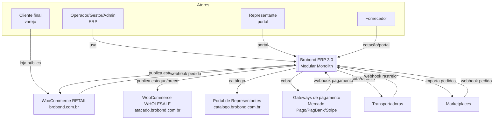
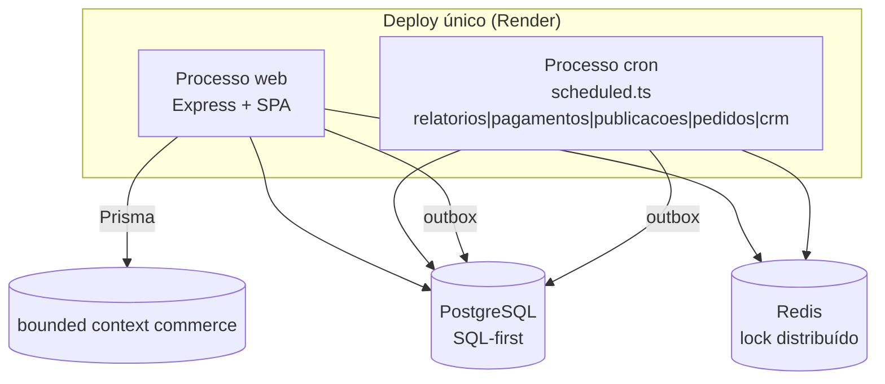
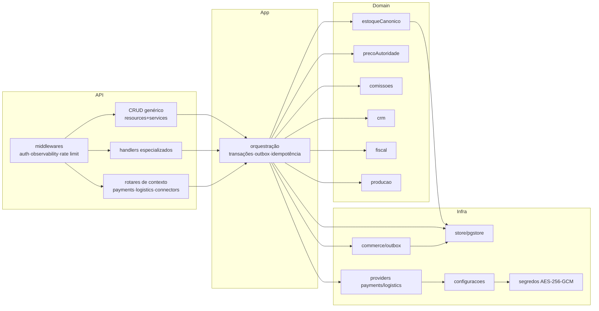
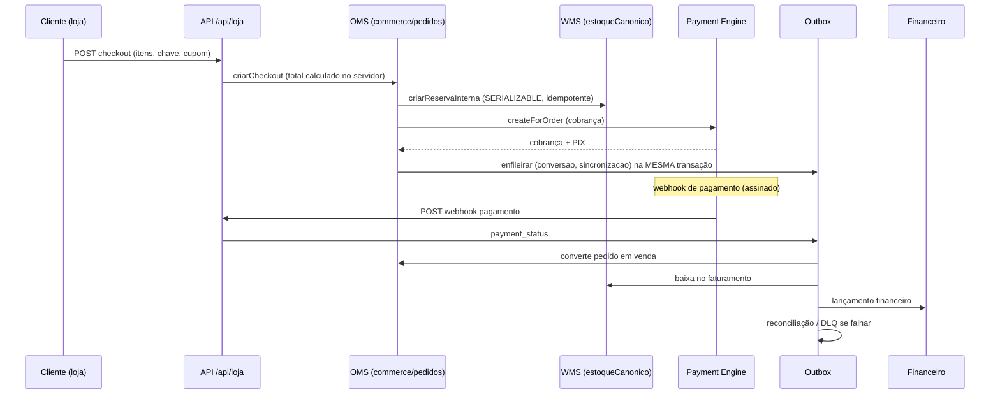
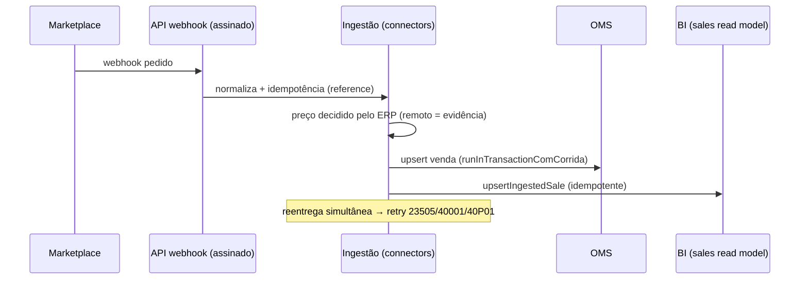

# TARGET-ARCHITECTURE — arquitetura-alvo (Fase 0)

**Data:** 2026-11-07 · **Branch:** `architecture/fase-0-blueprint`
**Decisão do Diretor:** **Modular Monolith**. Não criar microserviços.

> **Regra.** Este documento descreve a **arquitetura-alvo** e marca, para cada
> componente, se é **preservado**, **refatorado incrementalmente** ou
> **novo**. Não propõe reescrita integral.

---

## 1. Decisão central

O ERP **já é** um Modular Monolith: um único deploy (web + cron), com domínios
delimitados, kernel compartilhado (tenancy/RBAC/store/auditoria) e bounded
contexts desacoplados em `modules/` (payments, logistics, connectors).

A Fase 1 e a Fase 2 **formalizam e consolidam** esse modelo — não o substituem:

- **Preservar** o kernel (`empresa.ts`, `resources.ts`, `services.ts`,
  `store.ts`/`pgstore.ts`, `auditChain.ts`, `observability.ts`).
- **Preservar** a fonte de verdade SQL-first (`db/schema.sql` + migrations).
- **Preservar** o Prisma restrito ao commerce.
- **Preservar** a `commerce_outbox` como fila única.
- **Refatorar incrementalmente** onde há divergência (ex.: dois caminhos de
  ingestão Woo; padrões a formalizar).
- **Não criar** microserviços, segundo banco, segundo motor ou segunda fonte.

---

## 2. Camadas (alvo)

```
┌─────────────────────────────────────────────────────────────────────┐
│ APRESENTAÇÃO            client/ (React SPA + vitrine pública)        │
│   modules.ts (navegação) · App.tsx (rotas) · ModulePage · ui-kit     │
└───────────────────────────────┬─────────────────────────────────────┘
                                │ HTTP/JSON (/api/*)
┌───────────────────────────────▼─────────────────────────────────────┐
│ API                     server/src/index.ts (Express, 474 rotas)     │
│   middlewares: requireAuth · observability · rate limit · CORS       │
│   routers de bounded context: payments · logistics · connectors      │
└───────────────────────────────┬─────────────────────────────────────┘
                                │
┌───────────────────────────────▼─────────────────────────────────────┐
│ APLICAÇÃO               handlers + services.ts + modules/*/application│
│   orquestra transações, outbox, idempotência, auditoria              │
└───────────────────────────────┬─────────────────────────────────────┘
                                │
┌───────────────────────────────▼─────────────────────────────────────┐
│ DOMÍNIO                 regras: estoqueCanonico · precoAutoridade    │
│   modules/*/domain · comissoes · crm · fiscal · producao             │
└───────────────────────────────┬─────────────────────────────────────┘
                                │
┌───────────────────────────────▼─────────────────────────────────────┐
│ INFRAESTRUTURA          store.ts/pgstore.ts · segredos · config      │
│   commerce/outbox · connectors · providers (payments/logistics)      │
│   db: PostgreSQL (SQL-first) · Redis (lock) · Prisma (commerce)      │
└─────────────────────────────────────────────────────────────────────┘
```

### 2.1 KERNEL transversal (compartilhado por todos os módulos)

| Componente | Arquivo | Papel |
|---|---|---|
| Tenancy | `server/src/empresa.ts` | escopo por empresa, 404 cross-tenant, carimbo |
| Metadados | `server/src/resources.ts` | fonte única de recurso/campo/validação/RBAC |
| CRUD + RBAC | `server/src/services.ts` | `checkAccess`, execução genérica |
| Persistência | `server/src/store.ts`, `pgstore.ts`, `memdb.ts` | SQL parametrizado / memória (teste) |
| Validação | `server/src/validate.ts` | parsers por `FieldType` |
| Erros | `server/src/errors.ts` | `HttpError` (status, fields, code, details) |
| Auditoria | `server/src/auditChain.ts` | cadeia de hashes (tamper-evidence) |
| Observabilidade | `server/src/observability.ts` | request/correlation id, log estruturado |
| Segredos | `server/src/segredos.ts`, `chavesCifra.ts` | AES-256-GCM |
| Outbox | `server/src/commerce/outbox.ts` | fila única confiável |
| Cron | `server/src/scheduled.ts` | 5 processos isolados |

### 2.2 Comunicação entre módulos (padrões permitidos)

| Padrão | Quando | Mecanismo |
|---|---|---|
| **Chamada de serviço** (in-process) | leitura/escrita síncrona dentro da transação | import de serviço do kernel |
| **Evento de domínio interno** | notificar projeção/efeito *best effort* | módulo-folha (`eventosVenda.ts`, `sale-events.ts`) |
| **Outbox** | efeito externo confiável (webhook, publicação, estoque) | `enfileirarOutbox` (mesma transação) |
| **Webhook assinado** | entrada externa | rota pública + verificação de assinatura |

**Proibido:** publicar evento antes do commit; acessar tabela interna de outro
contexto; criar segundo outbox.

---

## 3. Diagramas C4

### 3.1 Nível 1 — Contexto (C4-L1)



> A loja pública **nativa** `/loja` (vitrine própria) sai de cena por decisão do
> Diretor; a experiência pública de varejo passa a ser a RETAIL WooCommerce.
> **Estado:** decisão registrada (ADR-0007); a superfície nativa **ainda está
> ativa** e a execução da retirada está **pendente** (Fase 3 — BL-015).
> Ver [`NATIVE-STORE-DECOMMISSION.md`](NATIVE-STORE-DECOMMISSION.md).

### 3.2 Nível 2 — Containers (C4-L2)



### 3.3 Nível 3 — Componentes do servidor (C4-L3)



### 3.4 Fluxo crítico — checkout → venda → estoque → pagamento → financeiro



### 3.5 Fluxo crítico — ingestão de pedido de marketplace



---

## 4. Preservar × refatorar (incremental)

| Componente | Ação | Motivo |
|---|---|---|
| Kernel (tenancy/RBAC/store/auditoria) | **Preservar** | Já implementa as garantias exigidas |
| `resources.ts` (metadados) | **Preservar** | Fonte única de recurso/validação/RBAC |
| SQL-first + migrations | **Preservar** | Fonte de verdade do schema |
| Prisma (commerce) | **Preservar restrito** | Bounded context; não migrar tudo |
| `commerce_outbox` | **Preservar** | Fila única com CAS/backoff/DLQ |
| Bounded contexts `modules/*` | **Preservar** | Já desacoplados |
| Dois caminhos Woo (`loja.ts` + `commerce/woocommerce/`) | **Refatorar incremental** | Unificar no multi-store (runbook) |
| Loja pública nativa `/loja` | **Descontinuar** | Decisão do Diretor |
| Padrões (API/evento/migration/auditoria) | **Formalizar** (Fase 1) | Hoje implícitos no código |
| Integridade cross-tenant de `crm_*` no banco | **Refatorar** (Fase 2) | GAP-P2-04 |
| Catálogo de unidades (`insumos.unidade`) | **Adiar** (GAP-P3-04) | Exige migração de dados |

---

## 5. Atributos de qualidade (alvo)

| Atributo | Como é atendido |
|---|---|
| Segurança | RBAC no servidor, tenancy fail-closed, segredos cifrados |
| Isolamento multi-tenant | kernel de tenancy aplicado a todo recurso |
| Consistência | transações + outbox; sem transação distribuída artificial |
| Idempotência | chave na outbox; índices únicos; retry de corrida |
| Observabilidade | request/correlation id, logs estruturados, health |
| Testabilidade | modo memória + gate PostgreSQL real |
| Manutenibilidade | kernel único, sem duplicação de regra |
| Extraibilidade futura | bounded contexts com contrato explícito |

---

*Próximo documento: [`DATA-ARCHITECTURE.md`](DATA-ARCHITECTURE.md).*
